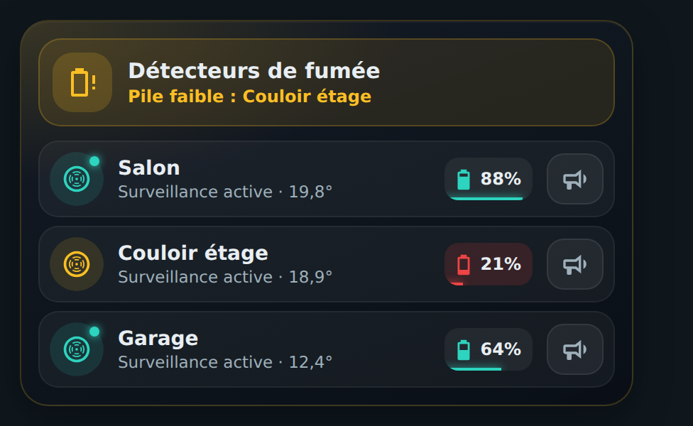
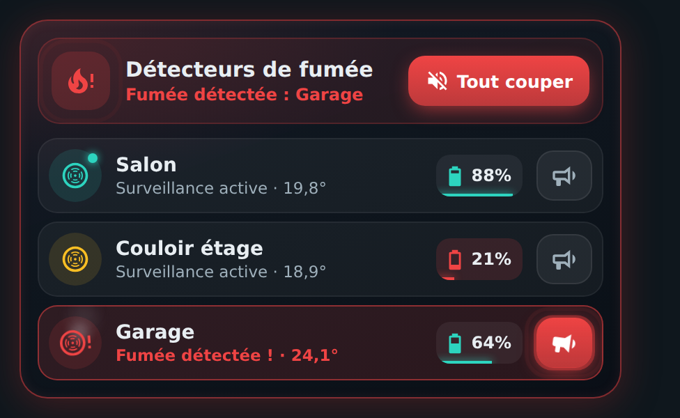

# 🔥 HOLM Smoke Card

[](https://hacs.xyz/)


**Vos détecteurs de fumée d'un seul coup d'œil : tout va bien, une pile faiblit, ou il y a de la fumée — et les sirènes à portée de doigt.**

HOLM Smoke Card rassemble vos **détecteurs de fumée équipés d'une sirène** (Zigbee, Z-Wave…) sur une carte claire. Un bandeau résume l'état de la maison, chaque détecteur a sa ligne avec l'état, la température, la pile et un bouton sirène.

> ✨ **Zéro YAML.** On choisit les sirènes dans l'éditeur visuel : les capteurs de fumée, de pile, de température et de défaut sont **trouvés automatiquement** à partir de l'appareil.

### En bref

- 🛡️ **Bandeau d'état** : « Tout est normal », « Pile faible : Couloir », « Fumée détectée : Garage »… la couleur de la carte suit l'état le plus grave.
- 🔥 **Alerte** : en cas de fumée ou de sirène, la carte pulse en rouge et un bouton **Tout couper** apparaît.
- 📢 **Sirènes** : déclenchement avec **confirmation** (pour éviter les fausses manœuvres), arrêt immédiat.
- 🔋 **Piles** : pourcentage avec jauge colorée, seuil « pile faible » réglable.
- 🌡️ Température de chaque détecteur, détecteurs indisponibles ou en défaut signalés.
- 👆 Un toucher sur un détecteur ouvre sa fiche Home Assistant.

| Tout va bien (ou presque) | Fumée détectée |
|---|---|
|  |  |

---

## Installation

### Avec HACS (recommandé)

1. HACS → menu ⋮ → **Dépôts personnalisés**.
2. Ajoutez `https://github.com/kaaribou/holm-smoke-card`, catégorie **Tableau de bord** (*Dashboard / Plugin*).
3. Recherchez la carte → **Télécharger**.
4. Rechargez la page (Ctrl + F5).

### Manuellement

1. Copiez `dist/holm-smoke-card.js` dans `config/www/community/holm-smoke-card/`.
2. **Paramètres → Tableaux de bord → ⋮ → Ressources → Ajouter** : `/local/community/holm-smoke-card/holm-smoke-card.js`, type **Module JavaScript**.
3. Rechargez la page.

---

## Utilisation

```yaml
type: custom:holm-smoke-card
title: Détecteurs de fumée
low_battery: 25
detectors:
  - entity: siren.detecteur_salon
    name: Salon
  - siren.detecteur_couloir
  - entity: siren.detecteur_garage
    battery_entity: sensor.detecteur_garage_batterie   # si non trouvé automatiquement
```

## Options

| Option | Description | Par défaut |
|---|---|---|
| `title` | Titre du bandeau | `Détecteurs de fumée` |
| `detectors` | Liste des sirènes (entité `siren` ou `switch`, ou objet ci-dessous) (**obligatoire**) | — |
| `low_battery` | Seuil de pile faible (%) | `25` |

Chaque détecteur accepte :

| Clé | Description |
|---|---|
| `entity` | Entité de la sirène (**obligatoire**) |
| `name` | Nom affiché (sinon le nom de l'appareil) |
| `smoke_entity` | Capteur de fumée (`binary_sensor`, classe `smoke`) |
| `battery_entity` | Capteur de pile (`sensor`, classe `battery`) |
| `temperature_entity` | Capteur de température |

## FAQ

| Problème | Solution |
|---|---|
| La pile ou la température n'apparaît pas | Les capteurs doivent appartenir au même appareil que la sirène ; sinon indiquez-les avec `battery_entity` / `temperature_entity`. |
| La nouvelle version ne s'affiche pas | Videz le cache (Ctrl + F5). |

> [!WARNING]
> Cette carte est une aide à la visualisation : elle ne remplace pas vos détecteurs ni leurs alarmes sonores.

---

## Un petit merci ?

La carte vous plaît ? Vous pouvez m'offrir une bière 🍺

[](https://paypal.me/kaaribou)

---

## Licence

Code : licence **MIT** — © kaaribou. Voir le [CHANGELOG](CHANGELOG.md).

Fait partie de la collection **HOLM** : [Carburant HOLM](https://github.com/kaaribou/carburant-holm) · [HOLM Navbar Card](https://github.com/kaaribou/holm-navbar-card) · [HOLM Music Card](https://github.com/kaaribou/holm-music-card) · [HOLM Sentinel Card](https://github.com/kaaribou/holm-sentinel-card).
